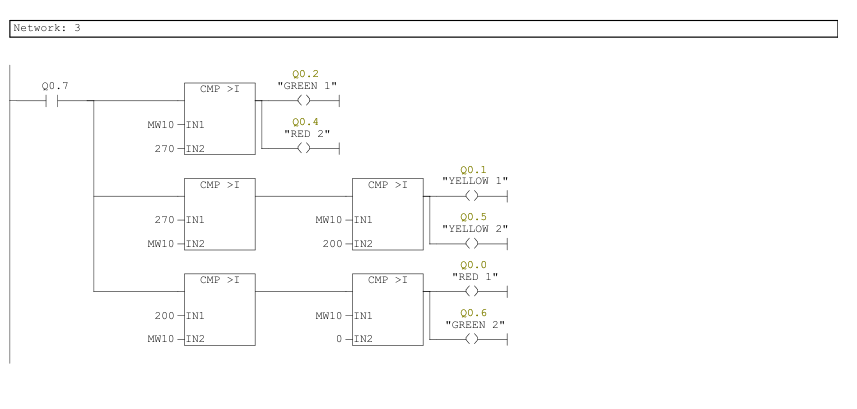

# Siemens PLC Process Automation

Four **Siemens SIMATIC ladder-logic studies** covering traffic sequencing, conveyor sorting, actuator coordination, and motor/temperature logic. The supplied exports identify an S7-300 station with a **CPU 314C-2 DP**, with the programs organized in OB1.

## Automation cases

| Case | Main functions | Ladder export |
| --- | --- | --- |
| [Traffic signals](projects/01_traffic_signals.md) | Start/stop latch, repeating 47-second timer, opposing lamp phases | [PDF](ladder/01_traffic_signals.pdf) |
| [Height-based box sorting](projects/02_height_based_box_sorting.md) | Height thresholds, class memory, timed pushers, and class counters | [PDF](ladder/02_height_based_box_sorting.pdf) |
| [Conveyor/actuator sequence](projects/03_conveyor_actuator_sequence.md) | Sensor-driven conveyor/actuator logic, one-second delay, and counter condition | [PDF](ladder/03_conveyor_actuator_sequence.pdf) |
| [Motor and temperature logic](projects/04_motor_temperature_logic.md) | Two-stage stop counting, delayed motor action, FC105 scaling, and piecewise output commands | [PDF](ladder/04_motor_temperature_logic.pdf) |

These are original **ladder-diagram PDF exports**, with an accompanying explanation report. An editable STEP 7 project, simulator scene, symbol table, and hardware configuration were not included in the attachments.

## Video demonstrations

This section is ready for the PLC simulation films. **No films have been uploaded yet.**

| Film | Status |
| --- | --- |
| Traffic-signal cycle and start/stop operation | Awaiting upload |
| Box classification, pusher action, and counting | Awaiting upload |
| Conveyor and actuator sequence | Awaiting upload |
| Motor sequence and temperature-dependent output | Awaiting upload |

See the [video folder and upload guide](videos/README.md) and [video catalog](videos/catalog.json). The original report refers to films for extra explanation, particularly for case 3; those films have not been reviewed here.

## How to review or reproduce

1. Open the [PLC explanation report](reports/plc_report.pdf) and the corresponding ladder export.
2. Use the [I/O overview](docs/IO_OVERVIEW.md) as an index to the printed addresses; the actual diagrams remain authoritative for contact types and connections.
3. Obtain the original editable STEP 7 project or reconstruct the printed networks in a compatible engineering environment.
4. Configure the actual I/O and simulation interface before recording a new run.

The original report and exported scaling block disagree on FC105 high/low limits, and the comparator types and analog representation need checking in the engineering project. These points are documented in [running and source notes](docs/RUNNING.md). No PLC program was compiled, downloaded, or simulated during repository preparation.

## Included material

- Four original ladder exports, preserved unchanged with descriptive filenames.
- The eight PLC pages from the original combined Persian report.
- Individual case explanations, an I/O index, and prepared film slots.
- [Credits](CREDITS.md), [source provenance](docs/SOURCE_MANIFEST.json), and [verification](docs/VERIFICATION.md).

The pneumatic circuits are organized in a separate repository. `Industrial_Control(1).pdf` was unavailable and was not used; full original task wording may therefore be incomplete.
